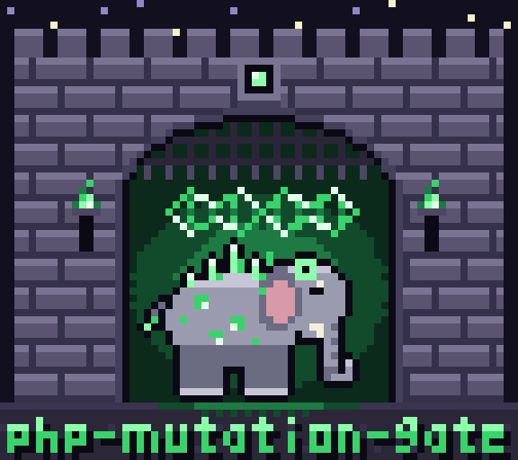

<p align="center">
  
</p>

<h1 align="center">php-mutation-gate</h1>

<p align="center">
  <strong>Mutation testing as a CI gate for PHP.</strong><br>
  Floors that only rise, sharded and cached runs, and every survivor with the command that reproduces it.
</p>

<div align="center">

[](https://github.com/nightworksio/php-mutation-gate/actions/workflows/mutation-gate.yml?query=branch%3Amain)
[](https://github.com/nightworksio/php-mutation-gate/actions/workflows/ci.yml?query=branch%3Amain)
[](https://sonarcloud.io/summary/new_code?id=nightworksio_php-mutation-gate)
[](https://scorecard.dev/viewer/?uri=github.com/nightworksio/php-mutation-gate)
[](https://nightworksio.github.io/php-mutation-gate/using/install/)
[](https://nightworksio.github.io/php-mutation-gate/using/)
[](https://github.com/nightworksio/php-mutation-gate/blob/main/LICENSE)

**[Documentation](https://nightworksio.github.io/php-mutation-gate/using/)** ·
[Install](https://nightworksio.github.io/php-mutation-gate/using/install/) ·
[CI setup](https://nightworksio.github.io/php-mutation-gate/using/ci/) ·
[Configuration](https://nightworksio.github.io/php-mutation-gate/using/configuration/) ·
[Features](https://nightworksio.github.io/php-mutation-gate/features/) ·
[Extending](https://nightworksio.github.io/php-mutation-gate/extending/) ·
[Contributing](https://nightworksio.github.io/php-mutation-gate/contributing/)

</div>

php-mutation-gate turns mutation testing into a check your pull requests must
pass. It is for PHP projects tested with Pest, Infection, PHPUnit, PhpSpec,
Codeception or Testo that want a mutation score they can hold in CI without
mutating the whole codebase on every push.

The mutating itself is done by the tool you already use, Pest's `--mutate` or
Infection, or, for PHPUnit on its own, PhpSpec, Codeception and Testo, by the
gate's own mutators. The gate decides:

- **what to mutate:** on a pull request, only the code the change reaches;
- **where to run it:** cut into shards that fill as many CI jobs as the work
  needs;
- **what to skip:** anything an earlier run already proved;
- **whether it may merge:** each tree of your code (a source directory, such
  as `src` or `app/Domain`) has a floor, the lowest score it may have, and
  the floor only rises. New code has a floor of its own, 100 by default.

Every surviving mutant arrives with the one command that reproduces it and a
sentence saying what the tests miss.

## What it has

- **A verdict you can trust.** A kill counts only with evidence: a named
  killer that passes on the unmutated code, or a signal or fatal error that
  ended the process. Timeouts and memory kills are checked against the
  unmutated tests, and anything the gate cannot judge is reported, never
  passed. [Trust](https://nightworksio.github.io/php-mutation-gate/features/trust/)
- **Floors that only rise**, per tree and per package of a monorepo, held in
  a committed baseline, with floors of their own for new code, for security
  mutants and for each code owner.
  [Floors](https://nightworksio.github.io/php-mutation-gate/features/floors/)
- **Only what a change reaches** is mutated on a pull request, and a
  scheduled full run catches the rest.
  [Reach](https://nightworksio.github.io/php-mutation-gate/features/reach/)
- **Fast runs:** shards cut by learned cost, a proof cache keyed by content in
  the GitHub cache, a directory, S3/R2, Cloud Storage or Azure Blob, likely
  killers first, static analysis that kills mutants before their tests,
  pruning, warm workers and a sampled mode for huge repositories.
  [Speed](https://nightworksio.github.io/php-mutation-gate/features/speed/)
- **Every CI:** GitHub Actions, GitLab CI, Bitbucket Pipelines, Azure DevOps,
  Buildkite, CircleCI and Jenkins, each with a ready definition from
  `init --ci`, and a JSON plan for any other.
  [CI setup](https://nightworksio.github.io/php-mutation-gate/using/ci/)
- **Reports for people and machines:** a sticky pull request comment, an HTML
  report with a heatmap, a digest for agents, JSON, JUnit, SARIF, GitLab Code
  Quality, SonarQube, Stryker, a badge and a trend, chat alerts, OpenTelemetry
  and an organisation dashboard.
  [Reporting](https://nightworksio.github.io/php-mutation-gate/features/reporting/)
- **Local use:** a pre-push hook, watch mode, a daemon that keeps the gate
  loaded, survivors in VS Code and PhpStorm, `stub` for a failing test to
  fill in, and `explain` for any mutant.
  [Local use](https://nightworksio.github.io/php-mutation-gate/using/local/)
- **Extensible:** mutators written once for every runner, and your own
  runners, reporters, stores and config formats from a package of your own.
  [Extending](https://nightworksio.github.io/php-mutation-gate/extending/)

[Features](https://nightworksio.github.io/php-mutation-gate/features/) lists
every one, with the decision behind it.

## Quick start

Install the gate with Composer, from this repository
([Install](https://nightworksio.github.io/php-mutation-gate/using/install/)
lists the requirements, the signed PHAR and the container image):

```sh
composer config repositories.mutation-gate vcs https://github.com/nightworksio/php-mutation-gate
composer require --dev "nightworksio/mutation-gate:dev-main" -W
```

Set the project up, then run the gate:

```sh
vendor/bin/mutation-gate init
vendor/bin/mutation-gate
```

`init` detects your runner, preset (Laravel, Symfony or a plain library) and
CI, asks what detection leaves open, writes a config, and adds
`.mutation-gate/` to `.gitignore`. The config is optional: with none, the gate
takes its trees from the `<source>` of `phpunit.xml`.

The run measures coverage once, mutates every tree and prints each tree's
score. Each surviving mutant is printed with its diff, the tests that ran it,
what they miss, and the commands that reproduce and explain it:

```text
src/Money.php:11  default/SmallerToSmallerOrEqual  survived, on a changed line  4e12c9d0139b
    @@ @@
    -        if ($amount < $limit) {
    +        if ($amount <= $limit) {
    Judged by: tests/MoneyTest.php::testFits
    Add a test that uses a value at the boundary of `$amount < $limit`. It is judged by `Acme\Tests\MoneyTest::testFits`.
    Reproduce: vendor/bin/mutation-gate reproduce 4e12c9d0139b
    Explain: vendor/bin/mutation-gate explain 4e12c9d0139b
```

Write each tree's floor at the score it measured, and commit it with the
config:

```sh
vendor/bin/mutation-gate baseline --write
git add .gitignore mutation-gate.php mutation-gate.baseline.json
```

From then on a score may not fall below its floor. `vendor/bin/mutation-gate
doctor` says what would fail or run slowly before a run finds out.
[Get started](https://nightworksio.github.io/php-mutation-gate/using/) walks
the same steps, and [reading the report](https://nightworksio.github.io/php-mutation-gate/using/reading-the-report/)
says what each part of it means.

## In CI

A CI run plans the work, mutates each shard in parallel, and judges the
result in a verdict job, which is the check to require.
`vendor/bin/mutation-gate init --ci` writes the definition for your CI. On
GitHub it uses this repository as an action, pinned to the commit of the gate
you installed, or calls its reusable workflow.
[Running the gate in CI](https://nightworksio.github.io/php-mutation-gate/using/ci/)
has a page for each CI, and the commands for any other.

Each release's PHAR is signed with the release key, whose fingerprint is
`5EAA 6082 E57F F4C5 42A2  EA66 B757 A4B1 1361 16D2`, and attested by GitHub;
[Security](https://nightworksio.github.io/php-mutation-gate/contributing/security/)
says how to check both.

## Documentation

| For | Read |
|-----|------|
| Using the gate | [Get started](https://nightworksio.github.io/php-mutation-gate/using/), [CI setup](https://nightworksio.github.io/php-mutation-gate/using/ci/), [configuration](https://nightworksio.github.io/php-mutation-gate/using/configuration/), [command line](https://nightworksio.github.io/php-mutation-gate/using/cli/), [reports](https://nightworksio.github.io/php-mutation-gate/using/reports/), [troubleshooting](https://nightworksio.github.io/php-mutation-gate/using/troubleshooting/) |
| What it does, and why it can be trusted | [Features](https://nightworksio.github.io/php-mutation-gate/features/) |
| Writing your own runner, reporter, store or mutators | [Extending the gate](https://nightworksio.github.io/php-mutation-gate/extending/) |
| Changing the gate itself | [Contributing](https://nightworksio.github.io/php-mutation-gate/contributing/), [architecture](https://nightworksio.github.io/php-mutation-gate/contributing/architecture/), [design decisions](https://nightworksio.github.io/php-mutation-gate/decisions/) |

## Performance

The [benchmark](https://nightworksio.github.io/php-mutation-gate/features/speed/#the-benchmark)
runs the gate against plain Infection and plain Pest on four pinned
open-source projects, with `bench.yml`: a cold full run, a warm full run, a
replay of each project's recent pull requests and an unchanged re-run, every
arm three times on one GitHub-hosted machine, and the gate sharded across
machines. Every scenario is shown, those where the gate is slower too.

<!-- bench:start -->

No benchmark result is committed. `bench.yml` measures one, and a pull request brings it here.

<!-- bench:end -->

## Its own gate

php-mutation-gate gates its own pull requests through its reusable workflow,
and its default branch publishes the badge above and this trend:

<p align="center">
  
</p>

## Contributing and security

- [Contributing](https://nightworksio.github.io/php-mutation-gate/contributing/)
  says what a contribution needs and how to run the checks locally, and
  [architecture](https://nightworksio.github.io/php-mutation-gate/contributing/architecture/)
  is the structure every change keeps to.
- Ask a question in the [Q&A category of Discussions](https://github.com/nightworksio/php-mutation-gate/discussions/categories/q-a).
- Report a vulnerability privately, as
  [Security](https://nightworksio.github.io/php-mutation-gate/contributing/security/)
  says.
- Everyone here keeps the [code of conduct](https://github.com/nightworksio/php-mutation-gate/blob/main/CODE_OF_CONDUCT.md).

## Licence

MIT. See [LICENSE](https://github.com/nightworksio/php-mutation-gate/blob/main/LICENSE). php-mutation-gate is made by
[NightWorksIO](https://nightworks.io).
